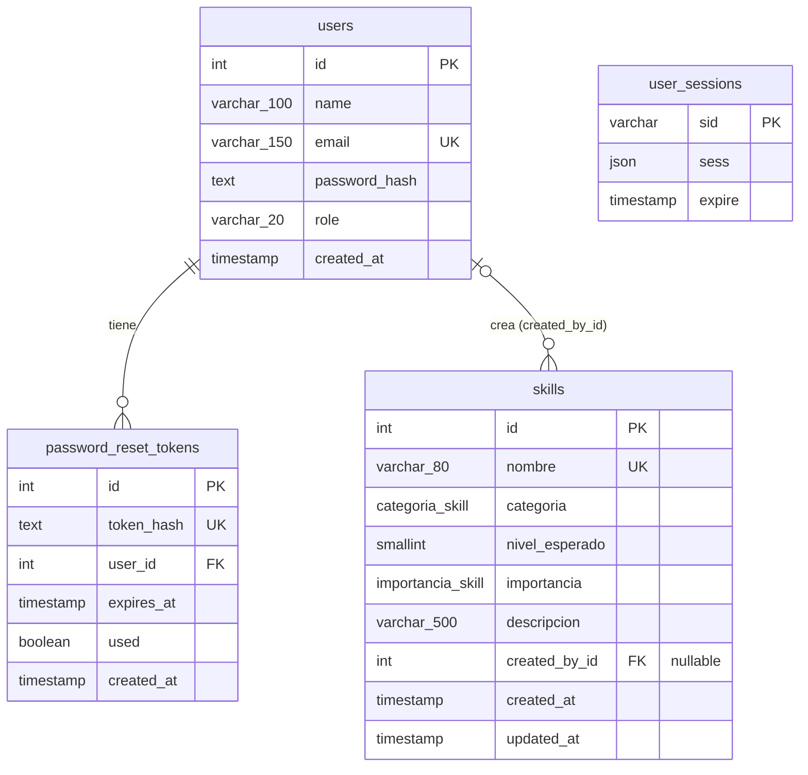

# Base de datos — Competency Hub

- **Motor:** PostgreSQL 16 (contenedor `skillbridge_db`, ver `docker-compose.yml`).
- **ORM:** Prisma 6 (`prisma/schema.prisma`). Los cambios se versionan como migraciones SQL en `prisma/migrations/`.
- **Responsables:** tablas de autenticación (`users`, `password_reset_tokens`, `user_sessions`): Jhair. Tabla `skills`, índices de búsqueda y seed: Isaac.

## Diagrama del modelo de datos



`user_sessions` la crea automáticamente `connect-pg-simple` (sesiones de Express) y no forma parte del esquema de Prisma.

## Tabla `skills` (entidad principal)

| Campo (Prisma) | Columna | Tipo | Restricciones |
|---|---|---|---|
| `id` | `id` | `SERIAL` | Clave primaria |
| `nombre` | `nombre` | `VARCHAR(80)` | Obligatorio, **único**, 3–80 caracteres (CHECK sobre el texto sin espacios extremos) |
| `categoria` | `categoria` | enum `categoria_skill` | Obligatorio: `TECNICA` (Técnica) o `CONDUCTUAL` (Conductual) |
| `nivelEsperado` | `nivel_esperado` | `SMALLINT` | Obligatorio, entero entre 1 y 5 (CHECK) |
| `importancia` | `importancia` | enum `importancia_skill` | Obligatorio: `BAJA`, `MEDIA`, `ALTA`, `CRITICA` (Crítica) |
| `descripcion` | `descripcion` | `VARCHAR(500)` | Obligatorio, 10–500 caracteres (CHECK) |
| `createdById` | `created_by_id` | `INTEGER` | Opcional, FK a `users.id`; `ON DELETE SET NULL` |
| `createdAt` | `created_at` | `TIMESTAMP(3)` | Por defecto `CURRENT_TIMESTAMP` |
| `updatedAt` | `updated_at` | `TIMESTAMP(3)` | Lo actualiza Prisma (`@updatedAt`) en cada modificación |

### Defensa en profundidad

Las reglas se validan en dos capas:

1. **Servidor (express-validator):** valida tipos, formatos, longitudes y valores permitidos y devuelve mensajes claros por campo.
2. **Base de datos:** tipos `VARCHAR(n)`, enums, `NOT NULL`, `UNIQUE` y restricciones `CHECK` (`skills_nivel_esperado_rango`, `skills_nombre_longitud`, `skills_descripcion_longitud`). Aunque alguien se saltara la validación de la aplicación, la BD rechaza datos inválidos.

Las restricciones `CHECK` no las genera Prisma; están escritas a mano en `prisma/migrations/20261122120000_skills/migration.sql`.

### Relación con usuarios

`skills.created_by_id` guarda qué usuario registró la skill (`req.session.user.id`). Es opcional porque las skills del seed no tienen autor. Si un usuario se elimina, sus skills se conservan y el campo pasa a `NULL` (`ON DELETE SET NULL`), porque el catálogo pertenece a la empresa y no a la persona.

## Índices

| Índice | Columnas | Tipo | Para qué sirve |
|---|---|---|---|
| `skills_pkey` | `id` | B-tree (PK) | Consultar, editar y eliminar por ID |
| `skills_nombre_key` | `nombre` | B-tree único | Garantiza nombres únicos y acelera la búsqueda exacta por nombre |
| `skills_nombre_trgm_idx` | `nombre gin_trgm_ops` | **GIN de trigramas** | Búsqueda parcial e insensible a mayúsculas (`ILIKE '%texto%'`) |
| `skills_categoria_importancia_idx` | `categoria, importancia` | B-tree compuesto | Filtro por categoría, o por categoría + importancia |
| `skills_created_by_id_idx` | `created_by_id` | B-tree | Consultar las skills creadas por un usuario y acelerar la FK |

### ¿Por qué un índice de trigramas?

El buscador del listado usa `contains` con `mode: 'insensitive'` de Prisma, que PostgreSQL ejecuta como `nombre ILIKE '%texto%'`. Un índice B-tree normal **no sirve** cuando el patrón empieza con `%`, porque solo puede buscar por prefijo. La extensión `pg_trgm` divide el texto en grupos de 3 caracteres (trigramas) y el índice GIN permite encontrar las filas que contienen esos trigramas sin recorrer toda la tabla.

### ¿Por qué un índice compuesto `(categoria, importancia)`?

Los filtros del listado son por categoría y, opcionalmente, por importancia. Un índice compuesto sirve para ambos casos, porque PostgreSQL puede usar su primera columna (`categoria`) sola. Para filtrar solo por importancia, el planificador puede recorrer el índice completo o la tabla; con pocas filas no hay diferencia práctica.

## Datos base (seed)

- Archivo: `prisma/seed.js`. Ejecutar con `npm run seed`.
- Carga 25 skills **ficticias**: 16 técnicas y 9 conductuales, con niveles del 1 al 5 y las cuatro importancias.
- Es **idempotente**: usa `upsert` por `nombre`, así que se puede ejecutar varias veces sin duplicar datos.

## Cómo preparar la base de datos localmente

```bash
docker compose up -d          # levanta PostgreSQL 16
npx prisma migrate deploy     # aplica todas las migraciones
npm run seed                  # carga el catálogo base
```

> **Nota sobre `prisma migrate dev`:** como `user_sessions` existe en la BD pero no en el esquema de Prisma, `migrate dev` detecta "drift" y pide resetear la base. Para generar una migración nueva sin perder datos se puede usar `prisma migrate diff --from-migrations prisma/migrations --to-schema-datamodel prisma/schema.prisma --shadow-database-url <url_bd_sombra> --script` y aplicarla con `prisma migrate deploy`.

## Medición: consultas con y sin índice

Script reproducible: [`docs/sql/medicion-indices.sql`](sql/medicion-indices.sql).

```bash
docker exec -i skillbridge_db psql -U admin -d skillbridge < docs/sql/medicion-indices.sql
```

**Método.** Con 25 filas PostgreSQL siempre recorre la tabla completa, porque es más barato que usar un índice. Por eso el script, dentro de una transacción, inserta **100 000 skills sintéticas** (además de las 25 del seed), ejecuta `ANALYZE` y mide cada consulta con `EXPLAIN (ANALYZE, BUFFERS)`: primero con los índices y luego después de eliminarlos (`DROP INDEX`). Al final hace `ROLLBACK`, así que la base queda exactamente como estaba, y `VACUUM ANALYZE` limpia las filas muertas.

**Entorno.** PostgreSQL 16.16 en Docker, en un portátil de desarrollo. Se hicieron 4 corridas; la primera, con caché fría, se descarta y se reporta la **mediana de las corridas 2 a 4**.

| Consulta | Plan con índice | Con índice | Plan sin índice | Sin índice | Mejora |
|---|---|---|---|---|---|
| Búsqueda parcial `nombre ILIKE '%04242%'` (10 resultados) | Bitmap Index Scan en `skills_nombre_trgm_idx` | **2,4 ms** | Seq Scan (100 025 filas) | 61,1 ms | ≈ 25× |
| Total para paginar: `count(*)` con `categoria` + `importancia` (10 717 filas) | Bitmap Index Scan en `skills_categoria_importancia_idx` | **5,1 ms** | Seq Scan | 10,4 ms | ≈ 2× |
| Filtro `categoria` + `importancia` + búsqueda `ILIKE '%0424%'` | Bitmap Index Scan (trigramas o compuesto, según el planificador) | **3,1 ms** | Seq Scan | 75,1 ms | ≈ 24× |

**Conclusiones.**

- El índice **GIN de trigramas** es el que más aporta: sin él, cada búsqueda del listado lee las 100 000 filas, aunque devuelva 10. Con él, PostgreSQL va directo a las candidatas.
- El índice **compuesto** mejora menos (≈ 2×) porque cada combinación categoría + importancia selecciona cerca del 11 % de la tabla. Igual se usa para calcular el total de páginas del listado filtrado.
- En la consulta combinada, el planificador elige el índice más selectivo. Casi siempre es el de trigramas; en una de las corridas usó el compuesto (9,3 ms), que igual es mucho más rápido que el Seq Scan.
- Con el volumen real de la PYME (decenas o cientos de skills) las consultas tardan menos de 1 ms con o sin índices. Los índices preparan el catálogo para crecer y cumplen el requisito de indexar los campos de búsqueda.
