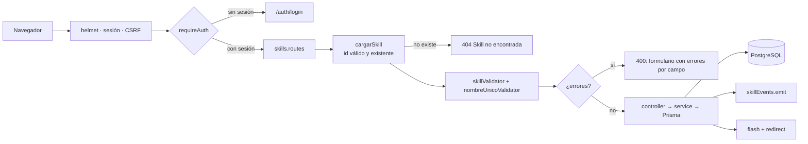
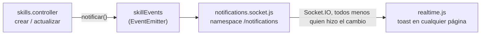

# Módulo de Skills (catálogo de competencias)

Responsable: **Isaac**. CRUD de la entidad principal del proyecto: las competencias (skills) técnicas y conductuales que la consultora espera de su equipo.

El esquema de la tabla, los índices, el seed y la medición de rendimiento están en [base-de-datos.md](base-de-datos.md).

## Estructura

| Archivo | Responsabilidad |
|---|---|
| `src/modules/skills/skills.routes.js` | Rutas y orden de los middlewares |
| `src/modules/skills/skills.controller.js` | Lee y sanea parámetros, llama al servicio y elige la vista |
| `src/modules/skills/skills.service.js` | Acceso a datos con Prisma (listar, obtener, crear, actualizar, eliminar) |
| `src/modules/skills/skills.validators.js` | Reglas de express-validator y nombre único |
| `src/modules/skills/skills.validation.js` | Respuesta ante errores de validación y lista blanca de campos |
| `src/modules/skills/skills.constants.js` | Valores permitidos, etiquetas y límites (fuente única) |
| `src/modules/skills/skills.events.js` | Eventos `skill:created` y `skill:updated` para el tiempo real |
| `src/views/skills/*.ejs` | `index` (listado), `detalle`, `nueva`, `editar`, `eliminar` y el partial `_form` |
| `tests/skills.validacion.test.js` | 24 pruebas del validador y del manejo de errores |
| `tests/skills.crud.test.js` | 8 pruebas de integración del CRUD |

## Flujo de una petición



`cargarSkill` solo se usa en las rutas con `:id`, y la validación solo en los `POST` de crear y editar.

## Rutas

Todas exigen sesión (`requireAuth` en `app.js`). Todos los `POST` requieren el token CSRF (`_csrf`), que ya incluyen los formularios.

| Método | Ruta | Descripción | Respuestas |
|---|---|---|---|
| GET | `/skills` | Listado paginado con búsqueda y filtros | 200 |
| GET | `/skills/nueva` | Formulario de creación | 200 |
| POST | `/skills` | Crea la skill | 302 → detalle · 400 con errores · 403 sin CSRF |
| GET | `/skills/:id` | Detalle | 200 · 404 |
| GET | `/skills/:id/editar` | Formulario de edición con los valores actuales | 200 · 404 |
| POST | `/skills/:id/editar` | Guarda los cambios | 302 → detalle · 400 · 403 · 404 |
| GET | `/skills/:id/eliminar` | Página de confirmación (sin JavaScript) | 200 · 404 |
| POST | `/skills/:id/eliminar` | Elimina la skill | 302 → listado · 403 · 404 |

- `:id` debe ser un entero positivo que quepa en `INTEGER` (máx. 2 147 483 647). Cualquier otro valor (`abc`, `1.5`, `0`, `-3`, `1e3`) responde **404**, igual que un id que no existe.
- Con JavaScript, los botones **Eliminar** abren el modal `confirm-dialog` del UI kit. Sin JavaScript llevan a la página de confirmación. En ningún caso se borra con un `GET`.
- Tras crear, editar o eliminar se muestra un mensaje flash (`req.session.flash`) en la página siguiente.

## Listado: paginación, búsqueda y filtros

`GET /skills?q=&categoria=&importancia=&page=`

| Parámetro | Valores | Si es inválido |
|---|---|---|
| `q` | Texto parcial del nombre, sin distinguir mayúsculas (máx. 80 caracteres) | Arreglos u otros tipos se ignoran; los espacios extra se recortan |
| `categoria` | `TECNICA`, `CONDUCTUAL` | Se ignora (muestra todas) |
| `importancia` | `BAJA`, `MEDIA`, `ALTA`, `CRITICA` | Se ignora (muestra todas) |
| `page` | Entero desde 1 | No numérico → página 1 · mayor que el total → última página |

- **Tamaño de página:** 10, en orden alfabético por nombre.
- Los filtros se combinan entre sí y con la paginación. Los enlaces Anterior/Siguiente conservan los filtros activos.
- La búsqueda usa `ILIKE '%texto%'`, acelerada por el índice GIN de trigramas. Los caracteres `%`, `_` y `\` se escapan, porque Prisma no lo hace en `contains`; sin esto, buscar `%` devolvería todo el catálogo.

## Validación en el servidor

Se aplica al crear y al editar (`skills.validators.js`). Si algo falla, se responde **400** con el formulario: un resumen arriba, cada mensaje junto a su campo (`aria-invalid`) y lo que el usuario escribió. No se toca la base de datos.

| Campo | Regla | Mensaje |
|---|---|---|
| `nombre` | Obligatorio; se recortan los espacios | El nombre es obligatorio. |
| | 3–80 caracteres | El nombre debe tener entre 3 y 80 caracteres. |
| | Letras, números, espacios y `. , + # ( ) / & ' -` | El nombre solo puede contener letras, números, espacios y los símbolos … |
| | Único sin distinguir mayúsculas (al editar se excluye la propia skill) | Ya existe una skill con ese nombre. |
| `categoria` | `TECNICA` o `CONDUCTUAL` | La categoría debe ser «Técnica» o «Conductual». |
| `nivelEsperado` | Entero del 1 al 5 (rechaza `0`, `6`, `3.5`, `tres`, `03`) | El nivel esperado debe ser un número entero del 1 al 5. |
| `importancia` | `BAJA`, `MEDIA`, `ALTA` o `CRITICA` | La importancia debe ser «Baja», «Media», «Alta» o «Crítica». |
| `descripcion` | Obligatoria; 10–500 caracteres | La descripción debe tener entre 10 y 500 caracteres. |
| | Sin caracteres de control (se permiten saltos de línea) | La descripción contiene caracteres no permitidos. |
| Cualquiera | Un solo valor de texto (no arreglos como `?nombre=a&nombre=b`) | Envía un único valor de texto. |

Además, la base de datos repite las reglas con tipos, enums, `UNIQUE` y restricciones `CHECK` (defensa en profundidad).

## Seguridad

| Riesgo | Medida |
|---|---|
| Acceso sin sesión | `requireAuth` en todas las rutas de `/skills` |
| CSRF | Token de sesión en todos los formularios `POST` (middleware global de Jhair); sin token → 403 |
| Inyección SQL | Solo consultas de Prisma (parametrizadas); `id` y filtros validados antes de consultar |
| XSS | Las vistas usan `<%= %>` (escapado) para todo dato del usuario; el nombre no admite `<` ni `>` |
| Asignación masiva | Solo se guardan los 5 campos validados (`matchedData`); `createdById` sale de la sesión, nunca del formulario |
| Borrado accidental | Confirmación obligatoria (modal o página) y borrado solo por `POST` |
| Detalles internos | Los errores inesperados van al manejador global (página 500 sin stack) |

## Eventos para el tiempo real

El CRUD no usa Socket.IO directamente. Después de guardar correctamente, llama a `notificar()` (`skills.events.js`), que emite un evento en `skillEvents`, un `EventEmitter` de Node. El módulo de tiempo real (Sergio) se suscribe a esos eventos y los reenvía a los navegadores. Así cada parte se puede probar por separado.



**Eventos que emite el CRUD** (en el servidor, `skillEvents`):

| Evento | Cuándo | 1.er argumento (datos públicos) | 2.º argumento (solo servidor) |
|---|---|---|---|
| `skill:created` | Tras crear | `{ id, nombre, categoria, nivelEsperado, importancia, por }` | `{ actorId }` |
| `skill:updated` | Tras editar | `{ id, nombre, categoria, nivelEsperado, importancia, por }` | `{ actorId }` |

- `por` es el nombre de quien hizo el cambio. `actorId` es su id; el módulo de tiempo real lo usa para **no** avisarle a esa persona, que ya ve el mensaje flash de confirmación.
- Si un oyente lanza un error, se registra en la consola y la petición continúa: la skill ya se guardó.
- No se emiten eventos cuando la validación falla ni al eliminar.

**Lo que recibe el navegador:** `src/modules/notifications/notifications.socket.js` reenvía cada evento por el namespace `/notifications` (con sesión obligatoria en el handshake) solo con `{ id, nombre, by, at }`, sin descripción ni ids de usuario. `src/public/js/realtime.js` lo muestra como un toast, por ejemplo: «Ana creó la skill «Docker»». Los detalles están en [tiempo-real.md](tiempo-real.md).

## Pruebas

```bash
docker compose up -d          # necesario para las pruebas de integración
npx prisma migrate deploy
npm test
```

- **`skills.validacion.test.js`** (24 pruebas, sin base de datos; Prisma simulado): datos válidos y lista blanca, obligatorios, longitudes, rango de nivel, enums, arreglos, patrón de nombre, nombre duplicado y respuesta HTTP 400 con errores por campo.
- **`skills.crud.test.js`** (8 pruebas, app real y PostgreSQL): rutas protegidas; crear (autor de la sesión, evento y flash); rechazo de datos inválidos y sin CSRF; listado con búsqueda, filtro y paginación; actualizar (evento y nombre duplicado); 404; eliminar con confirmación. Crean un usuario y skills con el prefijo `Prueba Jest` y los borran al terminar.
