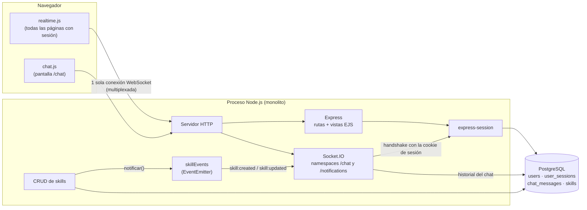

# Tiempo real: chat y notificaciones

- **Responsable:** Sergio.
- **Librería:** Socket.IO 4.8 (servidor `socket.io` y cliente servido por la propia app en `/socket.io/socket.io.min.js`).
- **Dónde corre:** dentro del mismo proceso y del mismo servidor HTTP que Express (`src/server.js` → `src/socket.js`). No se usa ningún servicio externo (Pusher, Firebase, Ably…).

## Arquitectura



## Cómo funciona Socket.IO por dentro

Socket.IO tiene dos capas: **Engine.IO** maneja la conexión (transporte, latido y reconexión) y **Socket.IO** agrega encima namespaces, salas, eventos y confirmaciones (acks).

1. **Handshake HTTP.** El cliente hace `GET /socket.io/?EIO=4&transport=polling`. Como es una petición HTTP normal al mismo dominio, **la cookie de sesión (`connect.sid`) viaja sola**. El servidor responde con el paquete de apertura de Engine.IO. Este es el de nuestra app:
   ```
   0{"sid":"…","upgrades":["websocket"],"pingInterval":25000,"pingTimeout":20000,"maxPayload":10000}
   ```
2. **Upgrade a WebSocket.** El cliente abre `ws://…/socket.io/?EIO=4&transport=websocket&sid=…`, prueba el canal (`2probe` → `3probe`), confirma con `5` y deja de usar polling.
3. **Mecanismo de respaldo.** Si un proxy o un firewall bloquea WebSocket, la conexión sigue funcionando con *HTTP long-polling*. La API es la misma, así que el código de la app no cambia.
4. **Latido (heartbeat).** Cada 25 s el servidor envía `2` (ping) y el cliente responde `3` (pong). Si no llega respuesta en 20 s, la conexión se da por perdida y el cliente **se reconecta solo**, con esperas crecientes. En el chat se ve "Se perdió la conexión. Reintentando…" y luego "Conexión restablecida.".
5. **Namespaces.** Sobre esa única conexión, el cliente entra a cada namespace con un paquete `40/chat,`. En ese momento corre el middleware de autenticación: si acepta, responde `40/chat,{"sid":…}`; si rechaza, responde `44/chat,{"message":"No autorizado"}`. Los dos namespaces comparten la misma conexión WebSocket (**multiplexación**); se verificó en el navegador que cada página abre una sola.
6. **Eventos y acks.** Enviar un mensaje es el paquete `42/chat,13["chat:send",{"content":"Hola"}]`. El `13` es el id del ack, y el servidor confirma con `43/chat,13[{"ok":true,…}]`.
7. **Salas (rooms).** Son grupos de sockets que existen solo en el servidor. El chat usa la sala `general`; las notificaciones usan una sala `user:<id>` por usuario, para excluir a quien hizo un cambio.

### ¿Por qué dos namespaces?

| Namespace | Quién se conecta | Para qué |
|---|---|---|
| `/chat` | Solo la pantalla `/chat` | Mensajes, historial y **lista de conectados al chat** |
| `/notifications` | Todas las páginas con sesión | Avisos de skills creadas o actualizadas |
| `/` (principal) | Nadie | No se usa, pero también exige sesión |

Si todo fuera por el mismo canal, cada vez que alguien navega entre páginas aparecería "X salió / X se unió al chat", y la lista de conectados incluiría a personas que no están en el chat.

## Contrato de eventos

**Namespace `/chat`**

| Dirección | Evento | Datos |
|---|---|---|
| Cliente → servidor | `chat:send` | `{ content }`, con ack `{ ok: true, message }` o `{ ok: false, error }` |
| Servidor → sala | `chat:message` | `{ id, userId, author, content, createdAt }` (también lo recibe el autor) |
| Servidor → sala | `chat:users` | `[{ id, name }]` (sin duplicar a quien tiene varias pestañas) |
| Servidor → sala | `chat:system` | `{ text, createdAt }` ("X se unió al chat" / "X salió del chat") |
| Servidor → socket | `chat:error` | `{ code: 'SESSION_EXPIRED', error }` y luego lo desconecta |

**Namespace `/notifications`**

| Dirección | Evento | Datos |
|---|---|---|
| Servidor → todos menos quien hizo el cambio | `skill:created` / `skill:updated` | `{ id, nombre, by, at }` (solo datos públicos) |

## Seguridad

| Medida | Qué evita | Dónde está |
|---|---|---|
| Autenticación en el handshake con la sesión de Express, en los 3 namespaces | Conexiones de usuarios sin sesión | `src/middlewares/socket-auth.middleware.js`, `src/socket.js` |
| El handshake debe venir del mismo origen (cabecera `Origin`) | *Cross-Site WebSocket Hijacking* | `isSameOrigin()` en el mismo middleware |
| El autor de cada mensaje se toma de la sesión, nunca de lo que envía el cliente | Suplantar a otro usuario | `chat.socket.js` (`socket.data.user`) |
| Validación de tipo y largo (1–500 caracteres, igual en cliente, servidor y BD) | Datos inválidos | `chat.validators.js`, `chat.ejs` (`maxlength`), CHECK en `chat_messages` |
| Saneamiento: caracteres de control, marcas bidireccionales y saltos de línea de más | Texto invisible o engañoso (*Trojan Source*) | `sanitizeContent()` en `chat.validators.js` |
| Salida escapada: `<%= %>` en EJS y `textContent` en el navegador | XSS | `partials/chat-message.ejs`, `public/js/chat-ui.js`, `toast.js` |
| Límite de 5 mensajes cada 5 s por usuario | Inundar el chat (*flooding*) | `isRateLimited()` en `chat.socket.js` |
| `maxHttpBufferSize` de 10 KB (el valor por defecto es 1 MB) | Mensajes gigantes que consumen memoria | `src/socket.js` |
| La sesión se vuelve a leer de la BD en cada mensaje | Seguir usando un socket después de cerrar sesión | `isSessionStillValid()` en `chat.socket.js` |
| Las notificaciones solo llevan `{ id, nombre, by, at }` | Filtrar datos personales | `toNotification()` en `notifications.socket.js` |

### Conexión segura (wss) en el despliegue

El cliente se conecta con `io('/chat')`, es decir, **al mismo origen de la página**. Si la app se sirve por HTTPS, la conexión usa `wss://` automáticamente, sin cambiar código. Detrás de un proxy inverso (por ejemplo, Nginx) hay que:

- Reenviar las cabeceras del upgrade de WebSocket:
  ```nginx
  location /socket.io/ {
    proxy_pass http://app:3000;
    proxy_http_version 1.1;
    proxy_set_header Upgrade $http_upgrade;
    proxy_set_header Connection "upgrade";
    proxy_set_header Host $host;
  }
  ```
- Con `NODE_ENV=production` la cookie de sesión es `secure`. Si el TLS termina en el proxy, Express debe confiar en él (`app.set('trust proxy', 1)`). Si no, `express-session` no envía la cookie, así que no se puede iniciar sesión y el handshake tampoco se autentica.

## Persistencia del historial

- Tabla `chat_messages` (ver [base-de-datos.md](base-de-datos.md)), con índice `(room, created_at)`.
- Al abrir `/chat` se cargan los **últimos 50 mensajes** desde la BD (renderizado en el servidor). Los nuevos llegan por WebSocket, sin recargar la página.

## Notificación de skills: flujo completo

1. El CRUD de skills guarda en la BD y llama a `notificar('skill:created' | 'skill:updated', skill, req.session.user)` (`skills.controller.js`).
2. `skills.events.js` emite el evento en `skillEvents`, un EventEmitter de Node, con los datos públicos y `{ actorId }` como segundo argumento, que solo usa el servidor.
3. `notifications.socket.js` está suscrito a esos eventos y los reenvía a `/notifications`, **excepto a la sala `user:<actorId>`**.
4. `realtime.js` muestra un toast: "Ana creó la skill «Docker»." o "Ana actualizó la skill «Docker»."

El CRUD no depende de Socket.IO: se puede probar sin sockets, y el tiempo real se puede probar sin el CRUD.

## Archivos

| Archivo | Responsabilidad |
|---|---|
| `src/socket.js` | Crea el servidor Socket.IO, comparte la sesión y registra los namespaces |
| `src/middlewares/socket-auth.middleware.js` | Autenticación del handshake y chequeo de `Origin` |
| `src/modules/chat/chat.socket.js` | Eventos del chat, usuarios conectados, límite de frecuencia y revalidación de sesión |
| `src/modules/chat/chat.validators.js` | Validación y saneamiento de mensajes |
| `src/modules/chat/chat.controller.js`, `chat.routes.js`, `chat.constants.js` | Pantalla `/chat`, historial y límites compartidos |
| `src/modules/notifications/notifications.socket.js` | Namespace `/notifications` y puente con `skillEvents` |
| `src/public/js/chat.js` | Cliente del chat (usa `ChatUI`, `FormValidation` y `Toast`) |
| `src/public/js/realtime.js` | Cliente de notificaciones (toast en todas las páginas) |
| `src/views/chat.ejs`, `src/views/partials/footer.ejs` | Pantalla del chat y carga de los scripts de tiempo real |

## Pruebas

```bash
npm test
```

Las pruebas del tiempo real **no necesitan PostgreSQL**: Prisma se reemplaza por un mock y las sesiones se guardan en memoria. Las de integración del CRUD de Isaac sí necesitan la BD levantada.

| Archivo | Pruebas | Qué cubre |
|---|---|---|
| `tests/chat.validacion.test.js` | 13 | Validación y saneamiento de mensajes; chequeo de `Origin` |
| `tests/auth.test.js` | 15 | Rutas protegidas, CSRF, registro (bcrypt), inicio y cierre de sesión, recuperación de clave con token de un solo uso y caducidad |
| `tests/chat.socket.test.js` | 14 | Socket.IO real en un puerto libre con dos clientes: handshake, mensajes en vivo, autor de la sesión, validación, límite de frecuencia, conectados, cierre de sesión y avisos de skills de punta a punta (crear una skill por HTTP → toast en el otro usuario) |

### Probarlo a mano

1. `docker compose up -d` y `npm run dev`.
2. Abre `http://localhost:3000` en una ventana normal y en otra de incógnito, con dos cuentas distintas. Usa `localhost`, no `127.0.0.1`.
3. **Chat:** entra a `/chat` en las dos ventanas y escribe. Fíjate en los mensajes en vivo, el contador "en línea" y los avisos de entrada y salida.
4. **Notificación:** deja una ventana en cualquier página y, con la otra cuenta, crea o edita una skill en `/skills`. También puedes usar los botones "Simular" de `/ui-kit`.
